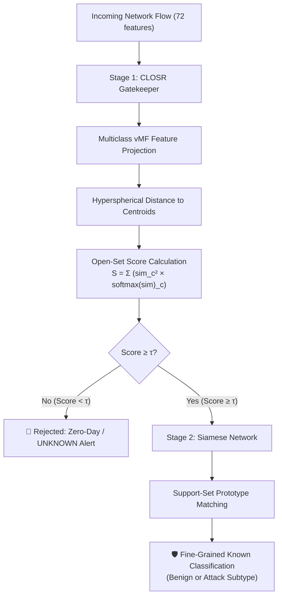

# CLOSR &rarr; Siamese Cascade: Robust Zero-Day Network Intrusion Detection

[](https://opensource.org/licenses/Apache-2.0)
[](https://www.python.org/downloads/)
[](https://tensorflow.org/)
[](https://doi.org/10.1109/TNSM.2026.3652529)

An advanced Network Intrusion Detection System (NIDS) combining **Contrastive Learning for Open-Set Recognition (CLOSR)** and **Siamese Metric Classification** into a high-accuracy, zero-day resilient, two-stage cascaded architecture.

---

## 📌 Overview

Supervised machine learning intrusion detection systems excel at categorizing known attack patterns but suffer catastrophic performance drops when confronted with unseen **zero-day attacks**. Conversely, traditional anomaly detectors generalize to unseen variations but exhibit notoriously high False Positive Rates (FPR), overwhelming security analysts.

This project addresses this fundamental trade-off through:
1. **CLAD (Contrastive Learning for Anomaly Detection):** Models benign network traffic as a von Mises–Fisher (vMF) distribution on a unit hypersphere using asymmetric contrastive loss. Zero-day threats emerge as embeddings anomalously distant from the benign centroid.
2. **CLOSR (Contrastive Learning for Open-Set Recognition):** Extends contrastive hyperspherical embeddings to multiclass domains, mapping benign traffic and each known attack class to distinct vMF distributions. Zero-day attacks map far from or orthogonal to all known class centroids.
3. **CLOSR &rarr; Siamese Cascade (Our Core Contribution):** While CLOSR delivers state-of-the-art open-set detection, its closed-set discrimination on known attack categories is slightly surpassed by dedicated metric-learning classifiers. We integrate both into an **end-to-end cascade**:
   - **Stage 1 (CLOSR Gatekeeper):** Flags and isolates traffic estimated to originate from unseen/zero-day attacks (`UNKNOWN`).
   - **Stage 2 (Siamese Classifier):** Performs fine-grained multiclass attribution on traffic accepted by Stage 1 as known.
   - **Joint Calibration & Error-Propagation Analysis:** Rigorous end-to-end threshold optimization, zero-day leakage quantification, and inference latency profiling.

---

## 🏛 Architecture



---

## 🔬 Benchmark & Scientific Protocol

### Dataset: Lycos2017
- **Raw Features:** 72 statistical flow features (packet counts, inter-arrival times, payload statistics, byte counts).
- **Identifier Columns Dropped:** `flow_id`, `src_addr`, `src_port`, `dst_addr`, `dst_port`, `ip_prot`, `timestamp` (strictly preventing metadata leakage).
- **Known Classes (12):** Benign (Class 0) + 11 known attack categories.
- **Zero-Day Hold-out Classes (2):** Categories with $<100$ samples held out strictly for zero-day evaluation (`Heartbleed` and `Web Attack (SQL Injection)`).

### Strict Anti-Leakage Protocol
- **Split Partitions:** Train, Validation (known classes only), Test (known classes), and Zero-Day (held out).
- **Pseudo-Zero-Day Calibration:** Stage 1 gatekeeper thresholds $\tau$ are calibrated using *leave-one-attack-out* cross-validation on the validation split. Real zero-day samples are strictly isolated and never accessed during training, centroid computation, or threshold selection.

---

## 🎯 Target Performance & Baselines

Upstream reference targets reported on the Lycos2017 benchmark:

| Model | Closed-Set Acc | Open-Set AUC | OpenAUC | FPR@95 |
|---|:---:|:---:|:---:|:---:|
| **CLOSR** | 0.9953 | 0.9740 | 0.9694 | Low |
| **Siamese Network** | **0.9977** | 0.7208 | 0.7192 | Moderate |
| **MultiStage** | 0.9966 | 0.8013 | 0.7985 | High |
| **DOC** | 0.9955 | 0.5703 | 0.5677 | High |
| **OpenMax** | 0.9956 | 0.7202 | 0.7170 | Moderate |
| **CRSOR** | 0.9949 | 0.7483 | 0.7445 | Moderate |
| **CLOSR &rarr; Siamese Cascade (Ours)** | **&ge; 0.9975** | **&ge; 0.9740** | **&gt; 0.9700** | **Minimised** |

*CLAD binary AUROC targets: Closed-set mean 0.9999, Open-set zero-day mean 0.9966.*

---

## 📂 Repository Structure

```text
├── AGENTS.md                  # Master project specification and engineering guide
├── NOTICE                     # Upstream attribution and licensing declarations
├── LICENSE                    # Apache-2.0 License
├── README.md                  # Project documentation & GitHub entrypoint
├── requirements.txt           # Pinned dependencies
├── configs/                   # Experiment and model configuration files (YAML)
│   ├── clad.yaml
│   ├── closr.yaml
│   ├── siamese.yaml
│   └── cascade.yaml
├── data/                      # Dataset location (lycos.csv, split indices)
├── docs/                      # Technical documentation, audits & reports
│   ├── UPSTREAM_INVENTORY.md  # Inspection of upstream reference modules
│   ├── DATA_CARD.md           # Dataset schema, feature list & split distributions
│   ├── DEVIATIONS.md          # Architecture decisions and upstream deviations
│   ├── BUGLOG.md              # Systematic bug tracking and resolution log
│   └── reports/               # PR milestones and Final Evaluation reports
├── results/                   # Evaluation artifacts, JSON/CSV metrics, and plots
│   ├── figures/               # t-SNE visualisations, ROC curves, Pareto frontiers
│   └── metrics/               # Machine-readable evaluation tables (mean &plusmn; std)
├── scripts/                   # Modular CLI entrypoints
│   ├── train.py               # Unified training engine (CLAD, CLOSR, Siamese)
│   ├── evaluate.py            # Comprehensive evaluation harness (AUROC, OpenAUC)
│   ├── calibrate.py           # Joint & pseudo-zero-day threshold calibration
│   ├── benchmark_latency.py   # Latency percentiles (p50/p95/p99) and throughput
│   ├── run_demo.py            # Interactive demo for evaluation and inspection
│   └── make_report.py         # Automated report & figure generation
├── src/
│   └── nids/                  # Core package
│       ├── config/            # Dataclass configurations & schema validation
│       ├── data/              # Loaders, class-balanced samplers & synthetic generator
│       ├── models/            # CLAD, CLOSRMLP, Siamese network backbones
│       ├── losses/            # CLAD asymmetric loss, CLOSR loss, Siamese contrastive loss
│       ├── training/          # Unified trainer, warmup-cosine schedules, checkpoints
│       ├── inference/         # Gatekeeper, centroid extractors, cascade pipeline
│       ├── evaluation/        # AUROC, OpenAUC, error propagation, leakage matrices
│       └── viz/               # t-SNE projections, ROC/PR curves, confusion matrices
├── tests/                     # Unit, integration, and numeric regression tests
│   ├── unit/
│   ├── integration/
│   └── regression/
└── third_party/
    └── CLOSR/                 # Read-only reference clone of upstream repository
```

---

## 🚀 Quick Start

### 1. Prerequisites & Installation

Clone the repository and install dependencies in a virtual environment:

```bash
git clone https://github.com/your-username/network-intrusion-detection.git
cd network-intrusion-detection

python3 -m venv venv
source venv/bin/activate
pip install -r requirements.txt
```

### 2. Dataset Setup

Place `lycos.csv` in the `data/` directory (or workspace root):

```bash
mkdir -p data
# Copy or symlink lycos.csv
cp /path/to/lycos.csv data/lycos.csv
```

> **Synthetic Data Mode:** If running on a lightweight dev environment without the full 800MB+ Lycos2017 dataset, pass `--synthetic` or `--smoke` to any script to generate schema-identical synthetic flows with matching feature counts and label spaces.

### 3. Training & Resuming

Our unified CLI entrypoint `scripts/run.py` drives training, resuming, and evaluation.

**Train CLOSR (Long Job — 200 epochs on Lycos2017):**
```bash
python scripts/run.py train --config configs/closr.yaml --set checkpoint_every=10
```

**Train CLAD (Long Job — 200 epochs on Lycos2017):**
```bash
python scripts/run.py train --config configs/clad.yaml --set checkpoint_every=10
```

**Resume Training from Checkpoint:**
Use the `--resume` CLI flag pointing to saved model weights:
```bash
python scripts/run.py train --config configs/closr.yaml --resume weights/closr_seed1.weights.h5
```

*Quick smoke run for verification:*
```bash
python scripts/run.py train --config configs/closr.yaml --set smoke=true
```

### 4. Calibration & Gatekeeper Tuning

Calibrate the rejection threshold $\tau$ using leave-one-attack-out validation:
```bash
python scripts/run.py calibrate --config configs/closr.yaml --checkpoint weights/closr_seed1.weights.h5
```

### 5. Running Evaluation & Cascade

Evaluate trained models on test and zero-day splits:

**Evaluate CLOSR:**
```bash
python scripts/run.py eval --config configs/closr.yaml --checkpoint weights/closr_seed1.weights.h5
```

**Evaluate CLAD:**
```bash
python scripts/run.py eval --config configs/clad.yaml --checkpoint weights/clad_seed1.weights.h5
```

**Run End-to-End Cascade Evaluation:**
```bash
python scripts/run.py cascade --config configs/cascade.yaml
```

### 6. Interactive Inspection Demo

Run the self-contained demonstration script to process sample flows and inspect decision paths:
```bash
python scripts/run_demo.py --samples 20
```

---

## 📊 Key Evaluation Metrics

- **Closed-Set Accuracy:** Classification accuracy on known-class test traffic.
- **Open-Set AUC:** Area under the ROC curve distinguishing known vs. zero-day flows using the open-set score.
- **OpenAUC:** Product of closed-set accuracy and open-set AUC ($\text{Acc}_{\text{closed}} \times \text{AUC}_{\text{open}}$).
- **FPR@95:** False positive rate when detecting 95% of zero-day attacks.
- **Zero-Day Leakage Rate:** Fraction of zero-day attacks erroneously admitted past Stage 1 into the known classifier.
- **Latency Percentiles:** Per-flow inference time (p50, p95, p99) and batch throughput (flows/second).

---

## 🛡 License & Attribution

This project is licensed under the **Apache License 2.0**. See the [LICENSE](LICENSE) file for details.

### Upstream Reference & Attribution
This project builds upon and extends foundational contrastive learning methodologies introduced by:
- **Paper:** Jack Wilkie et al., *"A Novel Contrastive Loss for Zero-Day Network Intrusion Detection"*, IEEE Transactions on Network and Service Management (TNSM), 2026. DOI: [10.1109/TNSM.2026.3652529](https://doi.org/10.1109/TNSM.2026.3652529).
- **Reference Codebase:** [jackwilkie/CLOSR](https://github.com/jackwilkie/CLOSR) (Apache-2.0 License).

### Attribution Convention
Every source file in this repository begins with a standard Apache-2.0 license header. In accordance with Apache-2.0, any file adapted from the upstream repository preserves original copyright notices and explicitly includes the attribution line:
```python
# Adapted from jackwilkie/CLOSR: <upstream path>
```

See the [NOTICE](NOTICE) file for full attribution and copyright notices.

